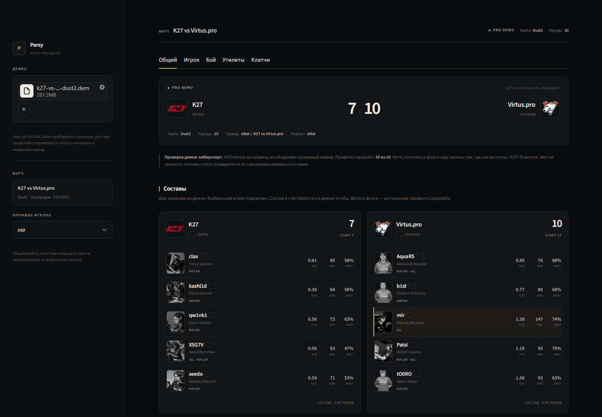

<p align="center">
  
</p>

<h1 align="center">Parsy</h1>

<p align="center">
  Локальный разбор демок CS2: K/D, ADR, KAST, утилита, клатчи и бомба в одном окне.
</p>

<p align="center">
  <a href="../../releases/latest"><strong>Скачать для Windows</strong></a>
  &nbsp;·&nbsp;
  <a href="DESKTOP_BUILD.md">Сборка из исходников</a>
</p>



## О проекте

Parsy — Windows-приложение для разбора демок CS2. Демка обрабатывается локально, а результат показывается в нативном окне приложения: без браузера и без загрузки файла на сторонний сервер.

Поддерживаются демки с матчмейкинга, HLTV и турнирных серверов. Для про-демок подтягиваются профили команд и игроков, логотипы и флаги.

## Возможности

- Загрузка `.dem` до 500 MB.
- Общая статистика матча, счёт, карта и количество раундов.
- Табы «Общий», «Игрок», «Бой», «Утилиты» и «Клатчи».
- K/D, ADR, KAST, HS%, стартовые стороны и детали по раундам.
- Разбор утилиты, клатчей и бомбы.
- Профили команд и игроков для про-демок.
- Переключение между игроками и командами.
- Тёмный русскоязычный интерфейс.
- Portable-версия и обычный установщик.

## Скачать

Открой раздел [Releases](../../releases/latest) и выбери один из вариантов.

### Установщик

1. Скачай `Parsy-Setup-*.exe`.
2. Запусти установщик.
3. Если Windows SmartScreen покажет предупреждение, нажми «Подробнее» → «Выполнить в любом случае». Установщик пока не подписан код-сертификатом.
4. Запусти Parsy из меню «Пуск» или с рабочего стола.

Права администратора не нужны. Приложение устанавливается в `%LOCALAPPDATA%\Programs\Parsy`.

Если Microsoft Edge WebView2 Runtime отсутствует, установщик предложит установить его автоматически. Для этого нужен интернет.

### Portable

1. Скачай `Parsy-Portable.zip`.
2. Полностью распакуй архив.
3. Запусти `Parsy.exe`.
4. Не запускай программу прямо из ZIP-архива.

Для Portable-версии WebView2 Runtime должен быть установлен в системе. Скачать: `https://go.microsoft.com/fwlink/p/?LinkId=2124703`.

### Требования

- Windows 10/11 x64.
- Microsoft Edge WebView2 Runtime.
- Около 450 MB свободного места.
- Интернет — для загрузки карточек команд и игроков. Сам разбор демки выполняется локально.

## Приватность

- Демка не отправляется на сторонние сервера.
- Локальный Streamlit-сервер слушает только `127.0.0.1` на случайном порту и закрывается вместе с приложением.
- Для карточек про-команд могут передаваться никнеймы и названия команд.
- Логи хранятся локально в `%LOCALAPPDATA%\Parsy\logs`.

## Сборка из исходников

Нужны Windows x64, Python 3.13 и — для установщика — Inno Setup 6/7.

```powershell
powershell -NoProfile -ExecutionPolicy Bypass -File .\build.ps1
```

Результат:

- `dist\Parsy\Parsy.exe` — Portable-папка;
- `dist\Parsy-Portable.zip` — Portable-архив;
- `dist\Parsy-Setup-1.0.0.exe` — установщик.

Подробности, версии зависимостей и диагностика: [DESKTOP_BUILD.md](DESKTOP_BUILD.md).

## Стек

- Python 3.13
- Streamlit
- demoparser2
- Plotly
- pandas / pyarrow
- pywebview
- PyInstaller
- Inno Setup

## Структура

```text
app.py                 Streamlit-приложение
main.py                desktop-оболочка pywebview и локальный сервер
Parsy.spec             конфигурация PyInstaller
assets/                иконка и логотип
installer/Parsy.iss    конфигурация Inno Setup
tools/make_icon.py     генератор иконки
build.ps1              сборка Portable и Setup
requirements.txt       зависимости приложения
requirements-desktop.txt  зависимости desktop-сборки
DESKTOP_BUILD.md       инструкция по сборке
```

## Ограничения

- Приложение пока не подписано код-сертификатом, поэтому SmartScreen может показывать предупреждение.
- Для карточек команд нужен интернет; при недоступности Liquipedia демка всё равно разбирается локально.
- Интерфейс и документация сейчас на русском языке.

## Статус

Версия `1.0.0`.
